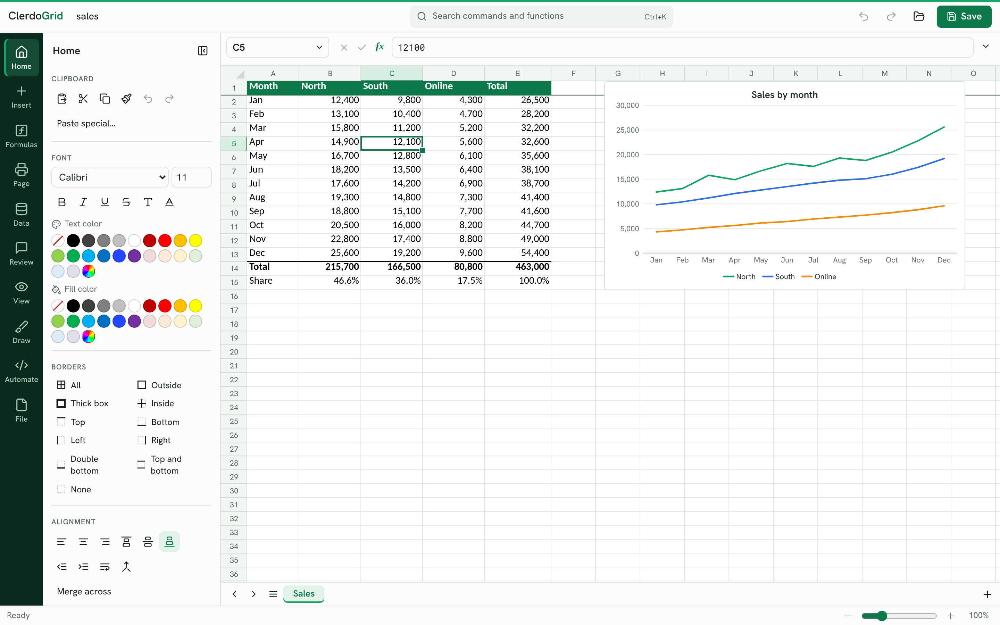
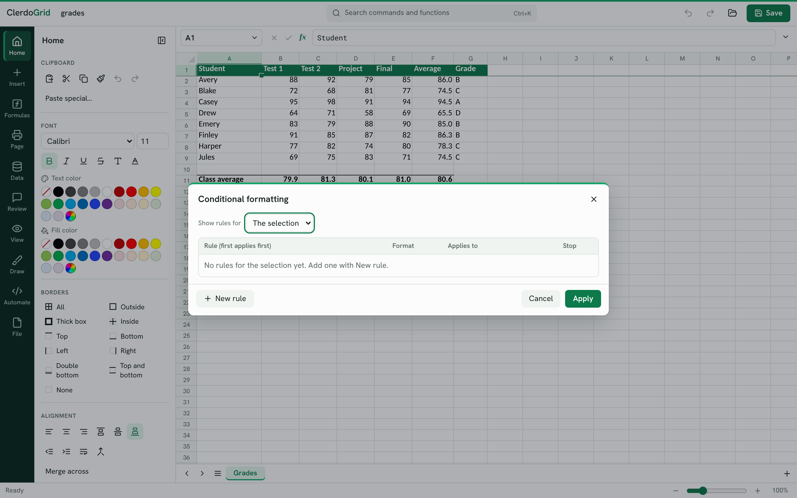
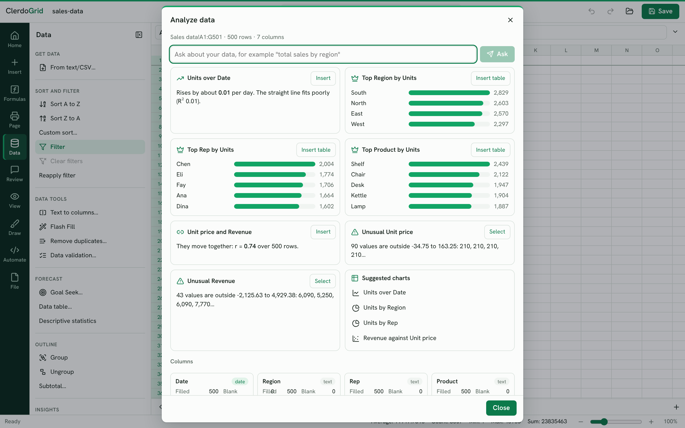

<p align="center"></p>

<h1 align="center">ClerdoGrid</h1>

<p align="center"><strong>A free, open-source spreadsheet app by Clerdo.</strong><br>
Calculate, analyse and chart data, with your files staying on your own device.<br>Windows, macOS, Linux, iPad and the web.</p>

<p align="center">
<a href="https://clerdo.app">Website</a> ·
<a href="https://github.com/clerdoapp/clerdogrid/releases/latest">Download</a> ·
<a href="https://clerdoapp.github.io/clerdogrid/">Open in your browser</a> ·
<a href="LICENSE-MIT">MIT</a> / <a href="LICENSE-APACHE">Apache-2.0</a>
</p>

<p align="center"></p>

## What it does

- **Calculate:** 514 worksheet functions with dynamic arrays, `LET`, `LAMBDA`, `GROUPBY`, `PIVOTBY`, `XLOOKUP`, full regular expressions and forecasting, on an engine that recalculates only what changed. Automatic or manual calculation, R1C1 references and the 1904 date system. The full list is in [docs/functions.md](docs/functions.md).
- **Edit fast:** region-aware typing of numbers and dates, formula autocomplete with argument help, the fill handle, Flash Fill with live suggestions, paste special, drag to move, and error checking with fixes.
- **Format:** fonts, fills, every border, alignment, custom number formats, cell styles, table styles, conditional formatting and checkboxes.
- **Analyse:** live PivotTables with slicers, timelines and PivotCharts, 66 chart types (including stock, surface, 3D and map charts) with trendlines and error bars, sparklines, outlines and subtotals, Goal Seek, data tables, Get Data with Refresh, and **Insights**, where you can ask about your data in your own language.
- **Print:** page setup, headers and footers, print areas, page breaks, page break preview, page layout view and ClerdoGrid's own PDF export.
- **Work together:** live editing with codes or a QR code, everyone's cursor on the sheet, share links, threaded comments, version history and passwords.
- **Automate:** scripts in a locked-down worker, a command-line tool and an MCP server for AI assistants.
- **Files:** opens and saves `.xlsx`, `.xlsb`, `.xls`, `.ods` and `.csv`, opens Excel 95 and older workbooks and password-protected files, and exports PDF, web pages, XML and JSON. Details in [docs/file-formats.md](docs/file-formats.md).
- **Your language:** 19 interface languages, with the whole app and right-to-left sheets mirrored for Arabic and Hebrew.
- **Private:** no account, no server, no tracking. Formulas reach the internet only if you turn that on.

<table>
<tr>
<td></td>
<td></td>
</tr>
<tr>
<td align="center">Charts</td>
<td align="center">Formatting</td>
</tr>
<tr>
<td></td>
<td></td>
</tr>
<tr>
<td align="center">Scripts</td>
<td align="center">Insights</td>
</tr>
<tr>
<td></td>
<td></td>
</tr>
<tr>
<td align="center">Dark mode</td>
<td align="center">iPad</td>
</tr>
</table>

The full list, with what's finished and what's basic, is in [docs/FEATURES.md](docs/FEATURES.md). What's next is in [ROADMAP.md](ROADMAP.md). Sample workbooks are in [examples/](examples/).

## Download

Get the latest build from the [Releases page](https://github.com/clerdoapp/clerdogrid/releases/latest):

| System | File |
|---|---|
| Windows | `.msi` installer, or the portable `.exe` / `.zip` |
| macOS | `.dmg` (Apple Silicon and Intel) |
| Linux | `.AppImage` (any distro), `.deb` (Ubuntu, Debian, Mint), `.rpm` (Fedora, openSUSE) or `.tar.gz` |
| iPad and web | Open [clerdoapp.github.io/clerdogrid](https://clerdoapp.github.io/clerdogrid/) in Safari, then **Share > Add to Home Screen** |
| Command line | `clerdogrid-cli-<version>.mjs` (runs with Node 20 or later; see [docs/cli.md](docs/cli.md)) |

The builds aren't code-signed yet:

- **Windows:** in the SmartScreen warning, click **More info**, then **Run anyway**.
- **macOS:** right-click the app, choose **Open**, then **Open** again.
- **Linux AppImage:** make it executable first (`chmod +x`).

On iPad, the home-screen app works offline after the first visit and keeps a copy of unsaved work.

## Build from source

```bash
npm install
npm run dev     # web app at http://localhost:5173
npm test
npm run dist    # desktop installers for this system
npm run examples        # rebuild the sample workbooks
npm run docs:functions  # rebuild docs/functions.md
npm run cli             # build the command-line tool into dist-cli/
```

More in [docs/development.md](docs/development.md), [docs/architecture.md](docs/architecture.md), [docs/releasing.md](docs/releasing.md), [docs/cli.md](docs/cli.md), [docs/mcp.md](docs/mcp.md) and [docs/collaboration.md](docs/collaboration.md).

## Contributing

Read [CONTRIBUTING.md](CONTRIBUTING.md) and [AGENTS.md](AGENTS.md). Report security problems as described in [SECURITY.md](SECURITY.md).

## Licence

The code is available under either the [MIT License](LICENSE-MIT) or the [Apache License 2.0](LICENSE-APACHE), at your choice. Third-party material is listed in [NOTICE](NOTICE) and [ASSETS.md](ASSETS.md). ClerdoGrid's name and icon belong to Clerdo.
