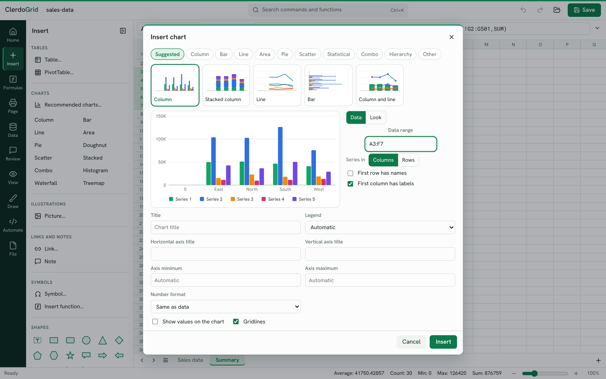
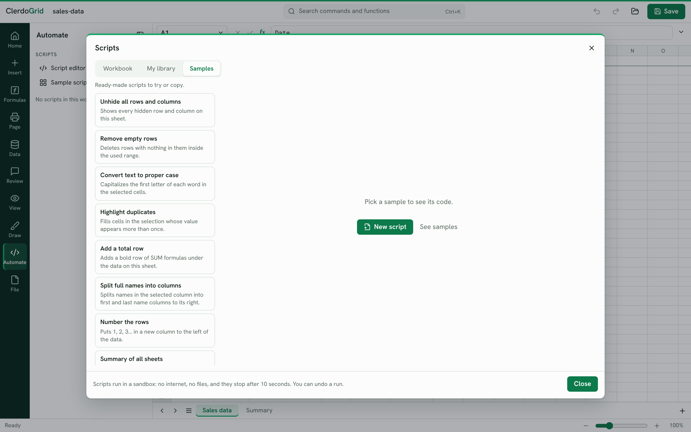
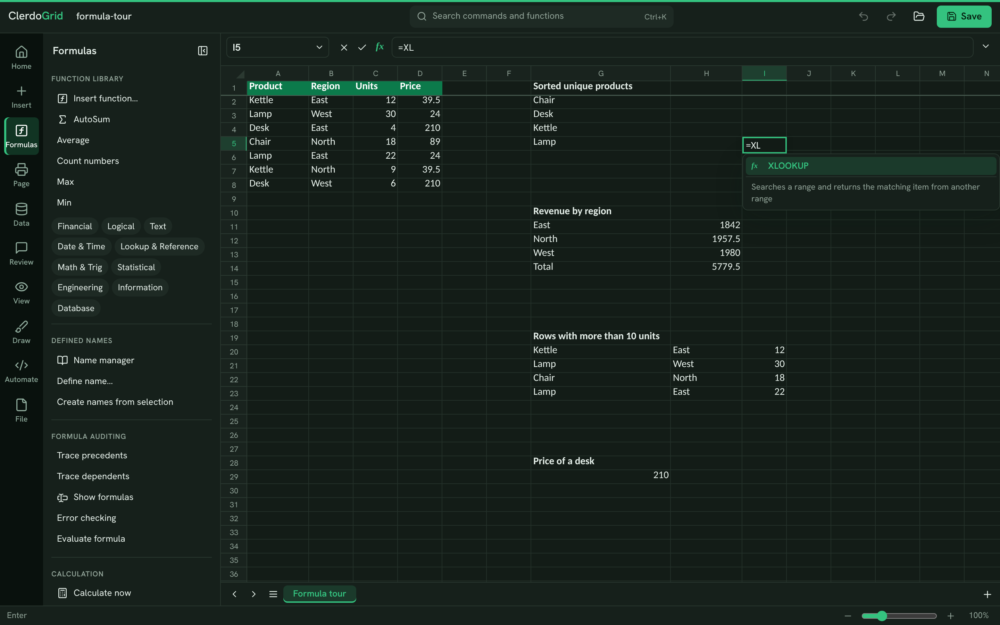
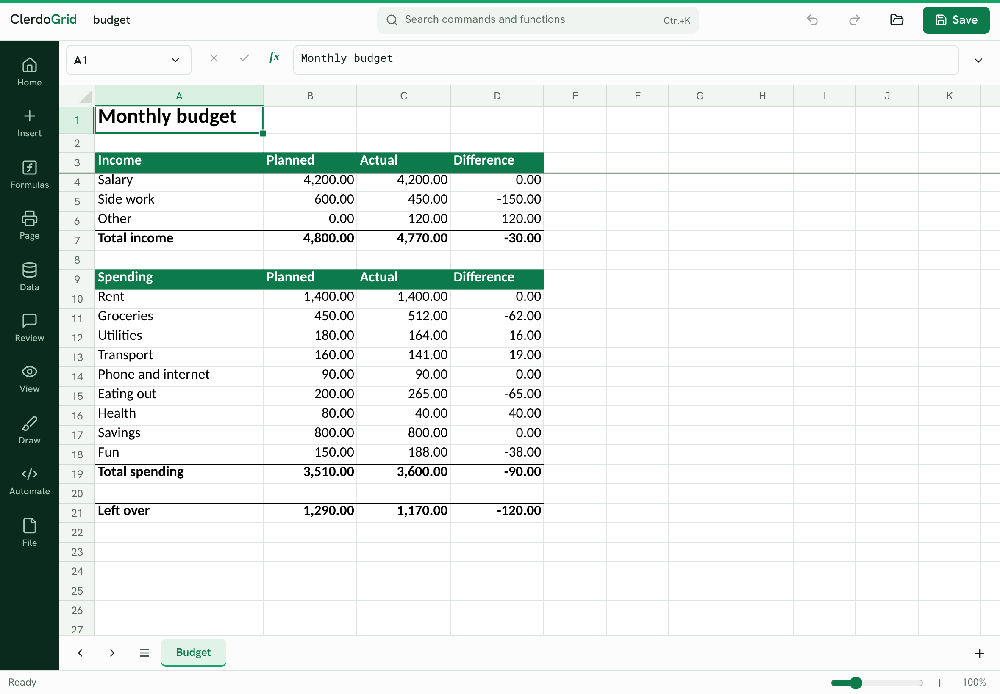

<p align="center"></p>

<h1 align="center">ClerdoGrid</h1>

<p align="center"><strong>A free, open-source spreadsheet app by Clerdo.</strong><br>
Calculate, analyse and chart data, with your files staying on your own device.<br>Windows, macOS, Linux, iPad and the web.</p>

<p align="center">
<a href="https://clerdo.app">Website</a> ·
<a href="https://github.com/clerdoapp/clerdogrid/releases/latest">Download</a> ·
<a href="https://clerdoapp.github.io/clerdogrid/">Open in your browser</a> ·
<a href="LICENSE-MIT">MIT</a> / <a href="LICENSE-APACHE">Apache-2.0</a>
</p>

<p align="center"></p>

## What it does

- **Calculate:** 510 worksheet functions across math, statistics, text, dates, lookup, finance, engineering, information and databases, with the results, error values and edge cases people expect from a spreadsheet. The full list is in [docs/functions.md](docs/functions.md).
- **Modern formulas:** dynamic arrays that spill, `LET`, `LAMBDA` with named functions, `MAP`, `REDUCE`, `SCAN`, `BYROW`, `BYCOL`, `FILTER`, `SORT`, `SORTBY`, `UNIQUE`, `SEQUENCE`, `XLOOKUP`, `XMATCH`, `GROUPBY`, `PIVOTBY`, `TEXTSPLIT`, regular expressions, array constants and legacy array formulas.
- **A real calculation engine:** a dependency graph that only recalculates what changed, volatile functions, circular reference detection, iterative calculation, defined names (workbook and sheet scope), tables with structured references, 3D references across sheets and `INDIRECT`/`OFFSET`.
- **Edit fast:** smart number, date, percent and currency recognition, formula autocomplete with argument hints and colored references, point-and-click references, F4 to cycle `$`, the fill handle with series, Flash Fill, Ctrl+Enter to fill a selection, copy and paste with other apps, paste special, drag to move, undo and redo.
- **Format:** fonts, colors, fills and gradients, every border style, alignment, wrap, rotation, merge, custom number formats, cell styles, table styles and cell checkboxes.
- **Organise:** insert and delete rows, columns and cells with every reference kept right, hide, group, freeze panes, sheet colors, multi-level sort, filters, remove duplicates, text to columns, drop-down lists, find and replace, go to special.
- **Analyse:** conditional formatting, 36 chart types (column, bar, line, area, pie, doughnut, scatter, bubble, radar, histogram, box and whisker, waterfall, funnel, treemap, sunburst, Pareto, combo and more), PivotTables, subtotals, Goal Seek, data tables, descriptive statistics and **Insights**, which suggests charts and summaries for your data.
- **Review:** threaded comments with replies, notes, spelling check, an accessibility check, protected sheets and ranges that stay editable.
- **Insert and draw:** pictures, shapes and text boxes, and pen or highlighter ink on the sheet.
- **Automate:** write scripts in TypeScript-style JavaScript that read and change the workbook. Scripts run in a locked-down worker with no network access and are saved inside the file.
- **Files:** opens and saves `.xlsx` (styles, formulas, merges, rules, validation, tables, comments, charts, pictures and shapes), opens `.xlsm` and `.xltx` with macros kept but never run, and opens and exports `.csv`. Print or save as PDF. Details in [docs/file-formats.md](docs/file-formats.md).
- **Private:** no account, no server, no tracking. Formulas never reach the internet.

<table>
<tr>
<td></td>
<td></td>
</tr>
<tr>
<td align="center">Charts</td>
<td align="center">Formatting</td>
</tr>
<tr>
<td></td>
<td></td>
</tr>
<tr>
<td align="center">Scripts</td>
<td align="center">Insights</td>
</tr>
<tr>
<td></td>
<td></td>
</tr>
<tr>
<td align="center">Dark mode</td>
<td align="center">iPad</td>
</tr>
</table>

The full list, with what's finished and what's basic, is in [docs/FEATURES.md](docs/FEATURES.md). What's next is in [ROADMAP.md](ROADMAP.md). Sample workbooks are in [examples/](examples/).

## Download

Get the latest build from the [Releases page](https://github.com/clerdoapp/clerdogrid/releases/latest):

| System | File |
|---|---|
| Windows | `.msi` installer, or the portable `.exe` / `.zip` |
| macOS | `.dmg` (Apple Silicon and Intel) |
| Linux | `.AppImage` (any distro), `.deb` (Ubuntu, Debian, Mint), `.rpm` (Fedora, openSUSE) or `.tar.gz` |
| iPad and web | Open [clerdoapp.github.io/clerdogrid](https://clerdoapp.github.io/clerdogrid/) in Safari, then **Share > Add to Home Screen** |

The builds aren't code-signed yet:

- **Windows:** in the SmartScreen warning, click **More info**, then **Run anyway**.
- **macOS:** right-click the app, choose **Open**, then **Open** again.
- **Linux AppImage:** make it executable first (`chmod +x`).

On iPad, the home-screen app works offline after the first visit and keeps a copy of unsaved work.

## Build from source

```bash
npm install
npm run dev     # web app at http://localhost:5173
npm test
npm run dist    # desktop installers for this system
npm run examples        # rebuild the sample workbooks
npm run docs:functions  # rebuild docs/functions.md
```

More in [docs/development.md](docs/development.md), [docs/architecture.md](docs/architecture.md) and [docs/releasing.md](docs/releasing.md).

## Contributing

Read [CONTRIBUTING.md](CONTRIBUTING.md) and [AGENTS.md](AGENTS.md). Report security problems as described in [SECURITY.md](SECURITY.md).

## Licence

The code is available under either the [MIT License](LICENSE-MIT) or the [Apache License 2.0](LICENSE-APACHE), at your choice. Third-party material is listed in [NOTICE](NOTICE) and [ASSETS.md](ASSETS.md). ClerdoGrid's name and icon belong to Clerdo.
